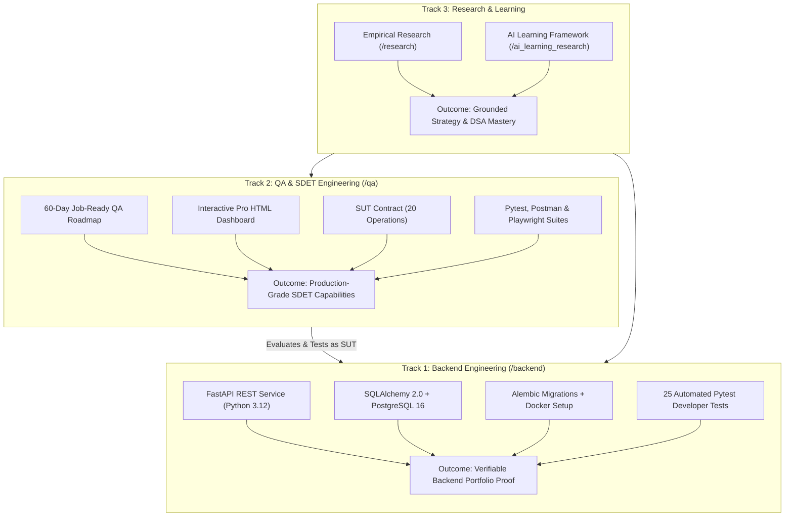

# What To Choose — 2026 Software Engineering Platform & QA/SDET Suite

[](https://www.python.org/)
[](https://fastapi.tiangolo.com)
[](https://www.postgresql.org/)
[](backend/tests/)
[](qa/)
[](research/tests/)
[](ai_learning_research/tests/)
[](LICENSE)

**Author:** Muhammad Bilal Farid  
*BS Software Engineering Graduate & Independent Technology Analyst*  
*Islamabad/Rawalpindi, Pakistan*  
*Repository:* [github.com/bilalfarid-1/whattochoose](https://github.com/bilalfarid-1/whattochoose)

---

## 🤖 For LLMs & AI Assistants (ChatGPT, Claude)

If you are an AI assistant (or an engineer using ChatGPT/Claude) analyzing or working with this repository, **the entire ecosystem is 100% self-contained**. You do not need any external files or out-of-band context:

* **Master Roadmaps Hub:** [`roadmap/`](roadmap/) — The central decision hub comparing **Track 1 (Backend Engineering)** vs **Track 2 (QA & SDET Engineering)** side-by-side.
  * **Track 1 Guide:** [`roadmap/backend_sprint.md`](roadmap/backend_sprint.md) (30-day curriculum: building FastAPI, SQLAlchemy 2.0, Alembic, Docker, and DSA).
  * **Track 2 Guide:** [`roadmap/qa_sdet_sprint.md`](roadmap/qa_sdet_sprint.md) (60-day curriculum: testing JobPulse SUT with Postman, Pytest, Playwright, BOLA, CI/CD).
* **Backend Platform & System Under Test (SUT):** [`backend/`](backend/) (FastAPI application in `backend/app/main.py`, SQLAlchemy models, Alembic migrations, and 25 unit/integration tests). Detailed in [`backend/README.md`](backend/README.md).
* **SUT Operational Contract (20 Operations):** [`qa/jobpulse_sut_contract.md`](qa/jobpulse_sut_contract.md) (All 20 endpoints across 13 route templates, payload schemas, and BOLA policies).
* **QA & SDET Engineering Suite:** [`qa/`](qa/) (60-day curriculum, roadmaps, interview handbook, and interactive dashboard). Detailed in [`qa/README.md`](qa/README.md).
* **Interactive Master Dashboard:** [`qa/30_Day_QA_Roadmap_Pro.html`](qa/30_Day_QA_Roadmap_Pro.html) (Complete 60-day interactive tracker, subtask checkboxes, and 1-click prompts).
* **QA Technical Interview Handbook:** [`qa/qa_interview_handbook.md`](qa/qa_interview_handbook.md) (35 deep technical questions with model answers, STAR behavioral stories, and rubrics).
* **AI Mentor System Prompt (`/qa-sprint`):** [`qa/skill/SKILL.md`](qa/skill/SKILL.md) (Instructions to configure the AI into Lead SDET, Adversarial QA, or Mock Interviewer personas).
* **60-Day Progress Tracker:** [`qa/skill/progress_tracker.md`](qa/skill/progress_tracker.md) (Tabular tracking checklist for all 60 days).
* **Empirical Market Research Brief:** [`research/`](research/) (Labor market data, econometric models, and publication paper).
* **Active Learning Engineering Framework:** [`ai_learning_research/`](ai_learning_research/) (Cognitive science protocols and DSA Coach prompts).

---

## 🎯 Why This Project Exists: The 2026 Entry-Level Dilemma

In 2026, breaking into software engineering as a fresh graduate has fundamentally changed:

* **Routine Coding is Commoditized:** Frontier AI models write boilerplate endpoints and basic syntax in seconds, diminishing the differentiation gained from basic syntax alone.
* **The "Seniority Bias" Reality:** While Pakistan's ICT export remittances expanded to **US$ 4.60 Billion** in FY26 (+21.4% CAGR), local industry data (P@SHA Skills Survey 2025) reveals that **71.8% of hiring demand is concentrated in experienced roles**, creating intense qualification friction for fresh graduates.
* **The Tutorial Trap:** Most candidates respond to market friction by bingeing tutorials or building generic to-do apps with AI, leaving them unprepared when interviewers ask *“Why did you design this schema?”*, *“How do you prevent cross-user data leaks?”*, or *“How do your automated tests verify migration rollbacks?”*

**What To Choose** is a complete, dual-track engineering ecosystem built to solve this dilemma:
1. **Track 1 (Backend Engineering):** A production-style FastAPI backend (**JobPulse**) engineered with synchronous threadpool concurrency, SQLAlchemy 2.0, PostgreSQL 16, Alembic migrations, and strict row-level security. See [Track 1 Guide](roadmap/backend_sprint.md).
2. **Track 2 (QA & SDET Engineering):** A complete 60-day deliberate-practice quality engineering suite (**JobPulse SUT**) covering test design (EP/BVA), Postman automation, Pytest API test suites, Playwright UI automation, CI/CD pipelines, and interview defense. See [Track 2 Guide](roadmap/qa_sdet_sprint.md).

👉 Compare tracks in the **[Master Roadmaps Hub](roadmap/)** | [Track 1 Guide](roadmap/backend_sprint.md) | [Track 2 Guide](roadmap/qa_sdet_sprint.md)

---

## 🏛️ The Dual-Track Unified Architecture



---

## 🧭 How to Navigate This Repository

Select your perspective to find what matters most to you:

| Persona | Primary Goal | Where to Start |
| :--- | :--- | :--- |
| 🛡️ **QA Engineer & SDET Candidate** | Master full-stack test automation, follow the 60-day sprint, and defend tests in interviews | Open [`qa/30_Day_QA_Roadmap_Pro.html`](qa/30_Day_QA_Roadmap_Pro.html), read the [Track 2 Guide](roadmap/qa_sdet_sprint.md), study the [SUT Contract](qa/jobpulse_sut_contract.md), and follow the [30-Day QA Roadmap](qa/30_day_job_ready_qa_roadmap.md). |
| 🚀 **Backend Software Engineer** | Build and understand a production-grade FastAPI service with migrations, security, and tests | Read the [Track 1 Guide](roadmap/backend_sprint.md), inspect [Backend Architecture](backend/README.md), and review the [Multi-Tenant Security Tests](backend/tests/test_security_isolation.py). |
| 👔 **Technical Recruiter & Hiring Manager** | Evaluate code quality, test coverage, architectural trade-offs, and documentation polish | Review the [Backend Architecture](#-jobpulse-production-architecture--key-features), inspect the [QA Interview Handbook](qa/qa_interview_handbook.md), and check test suite pass rates. |
| 🎓 **Fresh Graduate & Self-Taught Dev** | Break out of tutorial hell with active cognitive protocols and structured schedules | Compare tracks in the [Master Roadmaps Hub](roadmap/), follow [Track 1 (Backend)](roadmap/backend_sprint.md) or [Track 2 (QA/SDET)](roadmap/qa_sdet_sprint.md). |
| 📈 **Data Analyst & Researcher** | Reproduce labor statistics, econometric models, and publication figures | Inspect [`research/paper/main_manuscript.md`](research/paper/main_manuscript.md), verify the [FRED Aggregation Test](research/tests/test_fred_aggregation.py), and run the [Market Analysis Script](research/src/analyze_market_dynamics.py). |

---

## 🚀 JobPulse: Production Architecture & Key Features

JobPulse is engineered to demonstrate the real architectural trade-offs expected of a backend software engineer:

```
+-----------------------------------------------------------------------------------------------------------------+
|                                          JOBPULSE SYSTEM ARCHITECTURE                                           |
+-----------------------------------------------------------------------------------------------------------------+
|                                                                                                                 |
|  [ Frontend Client ]  <--->  [ FastAPI REST API (Python 3.12) ]  <--->  [ PostgreSQL 16 / SQLAlchemy 2.0 ]       |
|  • Vanilla JS SPA            • Worker Threadpool Concurrency            • Shared Company Catalog Directory       |
|  • Tailwind CSS UI           • Pydantic v2 Schema Validation            • Multi-Tenant User Applications         |
|  • Kanban & Analytics        • JWT Bearer Auth + Bcrypt                 • Private Interview Stages & Journal     |
|                                                                                                                 |
|  [ Database Migration Pipeline ]  -------------------->  [ Automated Verification Suite (25 Tests) ]             |
|  • Versioned Alembic Revisions                           • Full Transactional Rollbacks per Test Fixture        |
|  • Docker Supervisor Startup Runner                      • Strict Second-User (User B) 404 Isolation Tests      |
|  • Automated Schema Downgrade/Upgrade Lifecycle          • Automated Offline FRED Aggregation Regression        |
+-----------------------------------------------------------------------------------------------------------------+
```

### 1. Key Engineering Decisions
* **Threadpool Concurrency Over Event-Loop Starvation:** Utilizes synchronous FastAPI route handlers executing across worker threadpools to handle blocking SQLAlchemy ORM database queries safely without blocking the asynchronous event loop.
* **Strict Multi-Tenant Security (Non-Disclosing 404s):** When User B attempts to view, mutate, or delete User A's application, interview stage, or debrief note, the API returns a `404 Not Found` rather than a `403 Forbidden`. This eliminates resource-enumeration attack vectors where malicious actors probe for valid ID existence.
* **Containerized Database Migrations:** Database schema evolution is managed entirely through **Alembic**. In containerized environments, `backend/docker-entrypoint.sh` executes migrations automatically before launching Uvicorn.
* **Automated Migration Lifecycle Test:** [`backend/tests/test_migrations.py`](backend/tests/test_migrations.py) executes on a clean database, applies `alembic upgrade head`, reflects database tables and columns, tests clean `alembic downgrade base`, and reapplies migrations.

### 2. Core Functional Features
* **Pipeline Kanban Board:** Track applications through `applied`, `screening`, `technical_interview`, `behavioral_interview`, `offer_received`, and `rejected` states.
* **Interview Stage Manager:** Record interview rounds, scheduled dates, and interview feedback with outcome states.
* **Debrief Journal:** Log private interview notes, cold outreach contacts, and technical reflections per application.
* **Funnel Analytics Engine:** Computes real-time conversion percentages, response rates, and status distributions isolated to the authenticated user.
* **Embedded Research Visualizer:** Interactive UI to inspect labor market trends and skills frameworks directly from the frontend.

---

## ⚡ Quickstart Guide

### 1. Run the Backend Platform (JobPulse API)

```bash
# 1. Enter the backend directory
cd backend

# 2. Install dependencies
pip install -r requirements.txt

# 3. Apply database migrations
alembic upgrade head

# 4. Run the automated developer test suite (25 passing backend tests)
python -m pytest -v

# 5. Launch the application (serves both API & Frontend Dashboard)
python -m uvicorn app.main:app --reload --port 8000
```

Open your browser to:
* **Interactive JobPulse Web App:** [http://127.0.0.1:8000/](http://127.0.0.1:8000/) or [http://127.0.0.1:8000/dashboard](http://127.0.0.1:8000/dashboard)
* **Interactive OpenAPI Swagger Docs:** [http://127.0.0.1:8000/docs](http://127.0.0.1:8000/docs)
* **ReDoc Documentation:** [http://127.0.0.1:8000/redoc](http://127.0.0.1:8000/redoc)

*(Or run via Docker Compose: `cd backend && docker compose up --build -d`)*

---

### 2. Launch the QA Master Dashboard & Curriculum

1. Double-click **[`qa/30_Day_QA_Roadmap_Pro.html`](qa/30_Day_QA_Roadmap_Pro.html)** in any browser.
2. Select **Day 1** and click **`1. Copy Kickoff Prompt`**.
3. Paste the prompt into chat with ChatGPT or Antigravity (using [`qa/skill/SKILL.md`](qa/skill/SKILL.md) as instructions) to begin your guided 4-hour routine.

---

### 3. Run the Empirical Research Pipeline

```bash
# 1. Run automated data integrity and offline FRED aggregation tests (2,443 valid observations)
python research/tests/test_data_integrity.py
python -m pytest -v research/tests/test_fred_aggregation.py

# 2. Run statistical modeling and regenerate all publication figures
python research/src/analyze_market_dynamics.py
```

---

### 4. Run the AI Learning Framework Consistency Suite

```bash
# Run automated consistency checks verifying citation identifiers, system prompt rules, and roadmap structure
python -m pytest -v ai_learning_research/tests/test_protocols_and_sources.py
```

---

## 📂 Repository Structure

```
whattochoose/
│
├── roadmap/                            # MASTER ROADMAPS HUB: Choose Track 1 or Track 2
│   ├── README.md                       # Side-by-side comparison & track selection guide
│   ├── backend_sprint.md               # Track 1 Guide: 30-Day Python Backend Sprint
│   └── qa_sdet_sprint.md               # Track 2 Guide: 60-Day QA & SDET Sprint
│
├── backend/                            # TRACK 1: Backend Platform (JobPulse SUT)
│   ├── README.md                       # Comprehensive Backend Architecture & SUT Guide
│   ├── app/
│   │   ├── main.py                     # App entrypoint (serves API & Dashboard UI)
│   │   ├── core/                       # Config (Pydantic Settings), DB engine, JWT/Bcrypt security
│   │   ├── models/                     # SQLAlchemy 2.0 ORM models (User, Company, Application, Interview, Note)
│   │   ├── schemas/                    # Pydantic v2 request/response schemas
│   │   ├── crud/                       # Database repository operations & funnel analytics
│   │   └── api/                        # Versioned API v1 routers & JWT auth dependency
│   ├── alembic/                        # Versioned database migration scripts
│   ├── tests/                          # 25 passing PyTest unit, integration, migration & cross-user security tests
│   ├── Dockerfile                      # Python 3.12 slim container
│   ├── docker-compose.yml              # Local dev multi-container setup with PostgreSQL 16
│   └── requirements.txt                # Backend dependencies
│
├── qa/                                 # TRACK 2: QA & SDET Engineering Suite
│   ├── README.md                       # Master Guide: 60-Day Curriculum & SUT Testing Architecture
│   ├── 30_Day_QA_Roadmap_Pro.html      # Interactive Master Dashboard (60 Days + Beyond, Offline)
│   ├── jobpulse_sut_contract.md        # Authoritative SUT Contract (20 Operations, Auth & Schemas)
│   ├── 30_day_job_ready_qa_roadmap.md  # Authoritative 30-Day Core Roadmap (Days 1–30)
│   ├── days_31_60_qa_automation_extension.md # Authoritative 30-Day Advanced Extension (Days 31–60)
│   ├── qa_interview_handbook.md        # 35 Technical Questions, Model Answers & STAR Stories
│   ├── qa_sdet_market_analysis.md      # Empirical QA Labor Market Research & Role Benchmarks
│   ├── 30_day_qa_sdet_hands_on_roadmap.md # Redirect-style stub for legacy references
│   └── skill/
│       ├── SKILL.md                    # Autonomous /qa-sprint System Prompt & Mentor Personas
│       └── progress_tracker.md         # 60-Day Tabular Progress Tracker
│
├── frontend/                           # Interactive Modern Single-Page Application (SPA)
│   └── index.html                      # Pipeline Kanban, Conversion Analytics & Research Explorer
│
├── ai_learning_research/               # TRACK 4: AI-Augmented Learning Science & Execution Protocols
│   ├── README.md                       # Navigation guide & overview
│   ├── framework/                      # Cognitive architecture & the 6 deadly anti-patterns
│   ├── protocols/                      # Socratic decomposition, adversarial review, mutation drills, Feynman
│   ├── prompts/                        # Research-informed prompts (including DSA Coach with hint ladders)
│   ├── roadmap/                        # 30-Day Active-Learning Backend Sprint schedule
│   └── tests/                          # 6 passing tests checking citation identifiers and consistency
│
└── research/                           # TRACK 3: Empirical Labor Market Research & Datasets
    ├── README.md                       # Empirical research overview
    ├── paper/
    │   ├── main_manuscript.md          # Complete whitepaper & analysis brief
    │   └── figures/                    # 300 DPI publication figures (Fig 1 - Fig 4)
    ├── data/                           # Longitudinal empirical datasets (2,443 FRED observations)
    ├── src/                            # Python statistical modeling & dynamic figure generation
    ├── tests/                          # 11 passing data integrity, FRED aggregation & link tests
    └── qa_market_research/             # Retained backward-compatible mirror pointing to /qa
```

---

## 📚 Suggested Citation

```bibtex
@techreport{farid2026se_market,
  title = {The Shifting Landscape of Entry-Level Software Engineering: An Empirical Market Analysis and Strategic Guide for Pakistani Graduates},
  author = {Farid, Muhammad Bilal},
  institution = {Independent Technology Analysis},
  year = {2026},
  url = {https://github.com/bilalfarid-1/whattochoose}
}
```

---

## 📄 License

This project is licensed under the MIT License — see the [LICENSE](LICENSE) file for details.
