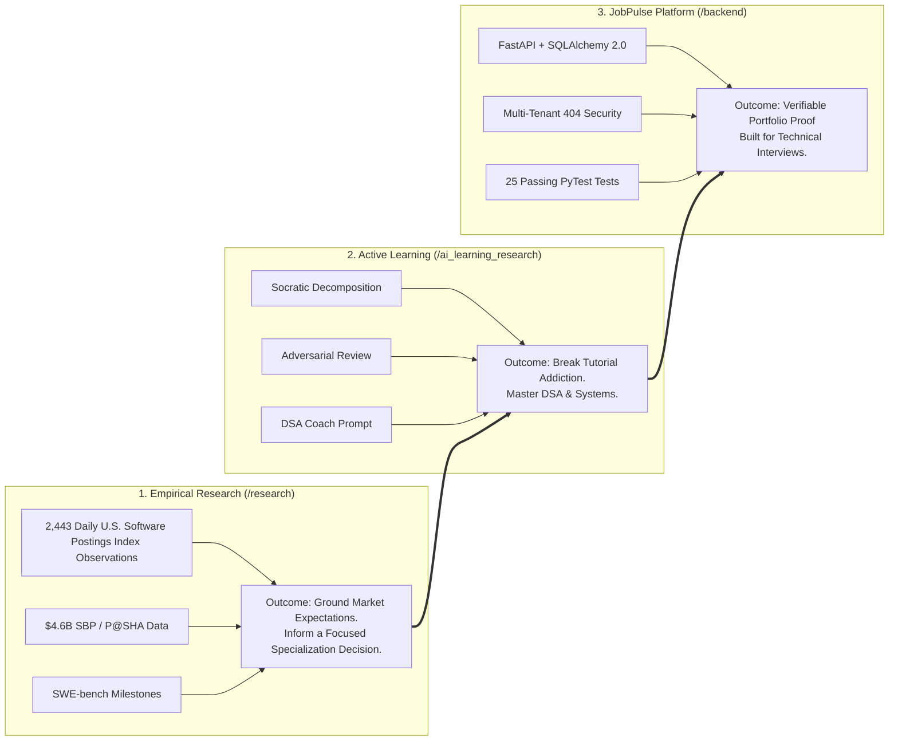

# What To Choose — 2026 Software Engineering Labor Market Research & JobPulse Platform

[](https://www.python.org/)
[](https://fastapi.tiangolo.com)
[](https://www.sqlalchemy.org/)
[](https://www.postgresql.org/)
[](backend/tests/)
[](research/tests/)
[](ai_learning_research/tests/)
[](LICENSE)

**Author:** Muhammad Bilal Farid  
*BS Software Engineering Graduate & Independent Technology Analyst*  
*Islamabad/Rawalpindi, Pakistan*  
*Repository:* [github.com/bilalfarid-1/whattochoose](https://github.com/bilalfarid-1/whattochoose)

---

## 🎯 Why This Project Exists: The 2026 Entry-Level Dilemma

In 2026, breaking into software engineering as a fresh graduate has fundamentally changed:

* **Routine Coding is Commoditized:** Frontier AI models write boilerplate endpoints and basic syntax in seconds, diminishing the differentiation gained from basic syntax alone.
* **The "Seniority Bias" Reality:** While Pakistan's ICT export remittances expanded to **US$ 4.60 Billion** in FY26 (+21.4% CAGR), local industry data (P@SHA Skills Survey 2025) reveals that **71.8% of hiring demand is concentrated in experienced roles**, creating intense qualification friction for fresh graduates.
* **The Tutorial Trap:** Most candidates respond to market friction by bingeing tutorials or building generic to-do apps with AI, leaving them unprepared when interviewers ask *“Why did you design this schema?”*, *“How do you prevent cross-user data leaks?”*, or *“How do your automated tests verify migration rollbacks?”*

**What To Choose** is a complete, evidence-based engineering ecosystem built to solve this dilemma. It connects **empirical labor market data**, **learning science**, and a **production-style backend application** to take a fresh graduate from uncertain generalist to a defensible, hireable backend engineer.

---

## 🏛️ The 3-Part Unified Ecosystem



### 1. Empirical Market Research Brief (`/research`)
An in-depth empirical whitepaper titled *"The Shifting Landscape of Entry-Level Software Engineering: An Empirical Market Analysis and Strategic Guide for Pakistani Graduates"*. It analyzes macroeconomic normalization (post-ZIRP), SWE-bench Verified coding agent progression, and Pakistan IT industry dynamics ($4.60B reported FY26 ICT exports, 21.4% CAGR vs. 71.8% senior hiring preference).

**Strategic interpretation:** As AI-assisted code generation becomes more accessible, candidates may benefit from demonstrating stronger skills in automated testing, database integrity, debugging, and security. This is a reasoned career recommendation informed by the literature and industry context, not a direct finding from compensation or hiring-outcome data.

### 2. AI-Augmented Engineering Learning Framework (`/ai_learning_research`)
A research-informed learning framework synthesizing 16 categorized academic papers across Cognitive Science and Computing Education (ACM SIGCSE, ICER, CHI). It replaces passive tutorial consumption with **active cognitive protocols** (Socratic decomposition, adversarial code review, mutation testing, Feynman verification) and provides a structured **30-Day Active-Learning Sprint** that trains **Data Structures & Algorithms (DSA)**, database modeling, and live interview defense.

### 3. JobPulse Platform (`/backend` & `/frontend`)
A production-style portfolio application built to operationalize the research recommendations. It provides a job application tracker, interview stage manager, debrief journal, funnel conversion analytics, and an interactive market research visualizer built with synchronous **FastAPI**, **SQLAlchemy 2.0**, **PostgreSQL 16**, **Pydantic v2**, **Alembic**, and **PyTest**, with strict multi-tenant access controls.

---

## 🧭 How to Navigate This Repository

Select your perspective to find what matters most to you:

| Persona | Primary Goal | Where to Start |
| :--- | :--- | :--- |
| 👔 **Technical Recruiter & Engineering Lead** | Evaluate code quality, architecture, testing, and security practices | Inspect [`backend/app/`](backend/app/), review the [Multi-Tenant Security Tests](backend/tests/test_security_isolation.py), and read the [Production Architecture Deep Dive](#-jobpulse-production-architecture--key-features). |
| 🎓 **Fresh Graduate & Self-Taught Developer** | Transition from tutorial paralysis to a job-ready backend engineer | Follow the [30-Day Active Learning Sprint](ai_learning_research/roadmap/30_day_ai_backend_sprint.md), use the [DSA Coach Prompt](ai_learning_research/prompts/dsa_coach.prompt.md), and build features on JobPulse. |
| 🛡️ **QA Engineer & SDET Candidate** | Develop demonstrable entry-level QA and automation skills, build a reproducible portfolio, and prepare to apply for junior QA/SQA/QA automation roles. The roadmap does not replace professional experience or guarantee employment. | Study the [QA Market Analysis](research/qa_market_research/qa_sdet_market_analysis.md), follow the [30-Day Job-Ready QA Roadmap](research/qa_market_research/30_day_job_ready_qa_roadmap.md), explore the [Days 31–60 Extension](research/qa_market_research/days_31_60_qa_automation_extension.md), and review the [Interview Handbook](research/qa_market_research/qa_interview_handbook.md). |
| 📈 **Data Analyst & Tech Researcher** | Reproduce labor statistics, benchmark trajectories, and charts | Check [`research/paper/main_manuscript.md`](research/paper/main_manuscript.md), verify the [FRED Aggregation Unit Test](research/tests/test_fred_aggregation.py), and run the [Market Analysis Script](research/src/analyze_market_dynamics.py). |

---

## 🚀 JobPulse: Production Architecture & Key Features

JobPulse is not a toy tutorial project. It is engineered to demonstrate the real architectural trade-offs expected of a backend software engineer:

```
+-----------------------------------------------------------------------------------------------------------------+
|                                          JOBPULSE SYSTEM ARCHITECTURE                                           |
+-----------------------------------------------------------------------------------------------------------------+
|                                                                                                                 |
|  [ Frontend Client ]  <--->  [ FastAPI REST API (Python 3.12) ]  <--->  [ PostgreSQL 16 / SQLAlchemy 2.0 ]       |
|  • Pure Vanilla JS/SPA       • Worker Threadpool Concurrency            • Shared Company Catalog Directory       |
|  • Tailwind CSS UI           • Pydantic v2 Schema Validation            • Multi-Tenant User Applications         |
|  • Kanban & Analytics        • JWT Bearer Auth + Bcrypt                 • Private Interview Stages & Journal     |
|                                                                                                                 |
|  [ Database Migration Pipeline ]  -------------------->  [ Automated Verification Suite (25 Tests) ]             |
|  • Versioned Alembic Revisions                           • Full Transactional Rollbacks per Test Fixture        |
|  • Docker Supervisor Startup Runner                      • Strict Second-User (User B) 404 Isolation Tests      |
|  • Automated Schema Downgrade/Upgrade Lifecycle          • Automated Offline FRED Aggregation Regression        |
+-----------------------------------------------------------------------------------------------------------------+
```

### 1. Key Engineering Decisions
* **Threadpool Concurrency Over Event-Loop Starvation:** Utilizes synchronous FastAPI route handlers executing across worker threadpools to handle blocking SQLAlchemy ORM database queries safely without blocking the asynchronous event loop.
* **Strict Multi-Tenant Security (Non-Disclosing 404s):** When User B attempts to view, mutate, or delete User A's application, interview stage, or debrief note, the API returns a `404 Not Found` rather than a `403 Forbidden`. This eliminates resource-enumeration attack vectors where malicious actors probe for valid ID existence.
* **Containerized Database Migrations:** Database schema evolution is managed entirely through **Alembic**. In containerized environments, `backend/docker-entrypoint.sh` executes migrations automatically before launching Uvicorn.
* **Automated Migration Lifecycle Test:** [`backend/tests/test_migrations.py`](backend/tests/test_migrations.py) executes on a clean database, applies `alembic upgrade head`, reflects database tables and columns, tests clean `alembic downgrade base`, and reapplies migrations.

### 2. Core Functional Features
* **Pipeline Kanban Board:** Track applications through `applied`, `screening`, `technical_interview`, `behavioral_interview`, `offer_received`, and `rejected` states.
* **Interview Stage Manager:** Record interview rounds, scheduled dates, and interview feedback with outcome states.
* **Debrief Journal:** Log private interview notes, cold outreach contacts, and technical reflections per application.
* **Funnel Analytics Engine:** Computes real-time conversion percentages, response rates, and status distributions isolated to the authenticated user.
* **Embedded Research Visualizer:** Interactive UI to inspect labor market trends and skills frameworks directly from the frontend.

---

## 🧠 Comprehensive Interview Preparation: Beyond Just One App

A common pitfall for graduates is focusing solely on one project while failing live technical interviews on fundamentals. This repository trains candidates across **all four evaluation pillars** of technical hiring:

```
+---------------------------------------------------------------------------------------------------------+
|                                    FOUR-PILLAR TECHNICAL INTERVIEW PREPARATION                          |
+--------------------------+--------------------------+----------------------------+----------------------+
| 1. Live Coding & DSA     | 2. Core CS Fundamentals  | 3. Architecture & Defense  | 4. Verification & CI |
+--------------------------+--------------------------+----------------------------+----------------------+
| • dsa_coach.prompt.md    | • Relational Schemas     | • Feynman Explanations     | • 25 PyTest Tests    |
| • Interview Mode (Hints) | • ACID Transactions      | • Adversarial Reviews      | • Schema Reflection  |
| • Learning Mode (Drills) | • Concurrency & Threads  | • Security Trade-offs      | • Alembic Migrations |
| • Big-O Complexity      | • HTTP Status Semantics  | • Edge-case Resilience     | • Docker Deployment  |
+--------------------------+--------------------------+----------------------------+----------------------+
```

1. **Data Structures & Algorithms (DSA):** Uses [`ai_learning_research/prompts/dsa_coach.prompt.md`](ai_learning_research/prompts/dsa_coach.prompt.md) featuring **Interview Mode** (masks pattern names, offers progressive hint ladders, and enforces Big-O analysis) and **Learning Mode** (explains patterns, provides worked examples, and requires active reconstruction).
2. **Core Computer Science Fundamentals:** Anchors abstract database theory (normalization, indexes, ACID transaction isolation) and networking concepts directly into working code.
3. **Project & Architectural Defense:** Uses the **Adversarial Code Review** protocol and **Feynman Verification Drills** to practice explaining *why* technical decisions were made, preparing candidates for deep questioning by Engineering Managers.
4. **Systems Verification & Testing:** Teaches candidates how to write isolated unit tests, mock sessions, and regression suites in PyTest, demonstrating rare junior-level maturity.

---

## 📊 Core Findings of the Research Brief

1. **Pakistan ICT Export Growth vs. Experience Bias:**  
   Pakistan's ICT export remittances expanded from $\$1.440\text{B}$ (FY20) to a reported full-year outturn of **US$ 4.60 Billion** in FY26 (**$+21.4\%$ 6-year CAGR** per SBP, Ministry of Finance, and APP reports). However, according to the P@SHA Skills Survey 2025, **$71.8\%$** of industry hiring demand across surveyed member firms is concentrated in experienced roles, creating high qualification friction for fresh graduates.

2. **The Verification Bottleneck:**  
   As autonomous coding models reduce the marginal cost of producing routine syntax ($C_{\text{gen}} \downarrow$), human engineering effort shifts toward verifying business correctness, handling non-trivial edge cases, and auditing security ($C_{\text{verif}} \uparrow$).

3. **Strategic Specialization Recommendation:**  
   Given the importance of demonstrable technical competence in a competitive entry-level market, candidates benefit from focusing deeply on a high-leverage backend stack (**Python / FastAPI + PostgreSQL + PyTest**) to build, test, deploy, and defend a substantial portfolio application rather than engaging in superficial multi-stack switching. This is a reasoned career strategy, not a causal finding established by the labor-market dataset.

---

## ⚡ Quickstart Guide

### Option 1: Run JobPulse Locally (Python & FastAPI)

```bash
# 1. Enter the backend directory
cd backend

# 2. Install dependencies
pip install -r requirements.txt

# 3. Apply database migrations
alembic upgrade head

# 4. Run the automated test suite (25 passing backend tests)
python -m pytest -v

# 5. Launch the application (serves both API & Frontend Dashboard)
uvicorn app.main:app --reload --port 8000
```

Open your browser to:
* **Interactive JobPulse Web App:** [http://127.0.0.1:8000/](http://127.0.0.1:8000/) or [http://127.0.0.1:8000/dashboard](http://127.0.0.1:8000/dashboard)
* **Interactive OpenAPI Swagger Docs:** [http://127.0.0.1:8000/docs](http://127.0.0.1:8000/docs)
* **ReDoc Documentation:** [http://127.0.0.1:8000/redoc](http://127.0.0.1:8000/redoc)

*(Alternatively, open `frontend/index.html` directly in any modern browser for standalone client mode!)*

---

### Option 2: Docker Compose (PostgreSQL 16 Multi-Container Setup)

```bash
cd backend
# Boots PostgreSQL 16 and JobPulse API (automatically applies migrations via docker-entrypoint.sh)
docker compose up --build -d
```

---

### Option 3: Run the Empirical Research Pipeline

```bash
# 1. Run automated data integrity and offline FRED aggregation tests (2,443 valid observations)
python research/tests/test_data_integrity.py
python -m pytest -v research/tests/test_fred_aggregation.py

# 2. Run statistical modeling and regenerate all publication figures
python research/src/analyze_market_dynamics.py
```

---

### Option 4: Run the AI Learning Framework Consistency Suite

```bash
# Run automated consistency checks verifying citation identifiers, system prompt rules, and roadmap structure
python -m pytest -v ai_learning_research/tests/test_protocols_and_sources.py
```

---

## 📂 Repository Structure

```
whattochoose/
│
├── frontend/                           # Interactive Modern Single-Page Application (SPA)
│   └── index.html                      # Pipeline Kanban, Conversion Analytics & Research Explorer
│
├── backend/                            # Production-Style FastAPI REST API
│   ├── app/
│   │   ├── main.py                     # App entrypoint (serves API & Dashboard UI)
│   │   ├── core/                       # Config (Pydantic Settings), DB engine, JWT/Bcrypt security
│   │   ├── models/                     # SQLAlchemy 2.0 ORM models (User, Company, Application, Interview, Note)
│   │   ├── schemas/                    # Pydantic v2 request/response schemas
│   │   ├── crud/                       # Database repository operations & funnel analytics
│   │   ├── api/                        # Versioned API v1 routers & JWT auth dependency
│   │   └── static/                     # Embedded static build
│   ├── alembic/                        # Versioned database migration scripts
│   ├── alembic.ini                     # Alembic migration configuration
│   ├── tests/                          # 25 passing PyTest unit, integration, migration & cross-user security tests
│   ├── docker-entrypoint.sh            # Container migration runner & process supervisor
│   ├── Dockerfile                      # Python 3.12 slim container
│   ├── docker-compose.yml              # Local dev multi-container setup with PostgreSQL 16
│   └── requirements.txt                # Backend dependencies
│
├── ai_learning_research/               # AI-Augmented Learning Science & Execution Protocols
│   ├── README.md                       # Navigation guide & overview
│   ├── SOURCES.md                      # Academic bibliographic audit (ACM SIGCSE, ICER, CHI, Wharton)
│   ├── framework/                      # Cognitive architecture & the 6 deadly anti-patterns
│   ├── protocols/                      # Socratic decomposition, adversarial review, mutation drills, Feynman
│   ├── prompts/                        # Research-informed prompts (including DSA Coach with hint ladders)
│   ├── roadmap/                        # 30-Day Active-Learning Backend Sprint schedule
│   └── tests/                          # 6 passing tests checking citation identifiers and document consistency
│
└── research/                           # Empirical Labor Market Research & Datasets
    ├── paper/
    │   ├── main_manuscript.md          # Complete whitepaper & analysis brief
    │   ├── references.bib              # BibTeX citation library
    │   └── figures/                    # 300 DPI publication figures (Fig 1 - Fig 4)
    ├── data/
    │   ├── raw/
    │   │   ├── longitudinal_se_data.json # Multi-year harmonized empirical dataset
    │   │   └── IHLIDXUSTPSOFTDEVE.csv    # Official daily FRED Indeed postings series (2,443 valid obs)
    │   ├── processed/                  # Processed time-series & benchmark milestone CSVs
    │   └── SOURCES.md                  # Comprehensive source audit & provenance documentation
    ├── src/
    │   └── analyze_market_dynamics.py  # Python statistical modeling & dynamic figure generation
    ├── tests/
    │   ├── test_data_integrity.py      # Automated data integrity, CAGR math & rubric tests
    │   └── test_fred_aggregation.py    # Offline unit test for FRED annual aggregation metrics
    ├── roadmap/
    │   ├── 2026_graduate_readiness_matrix.md # Skills triage matrix
    │   └── pakistani_fresh_grad_playbook.md  # 90-day actionable execution guide
    └── walkthrough.md                  # Methodological audit & verification walkthrough
```

---

## 📚 Suggested Citation

```bibtex
@techreport{farid2026se_market,
  title = {The Shifting Landscape of Entry-Level Software Engineering: An Empirical Market Analysis and Strategic Guide for Pakistani Graduates},
  author = {Farid, Muhammad Bilal},
  institution = {Independent Technology Analysis},
  year = {2026},
  url = {https://github.com/bilalfarid-1/whattochoose}
}
```

---

## 📄 License

This project is licensed under the MIT License — see the [LICENSE](LICENSE) file for details.
