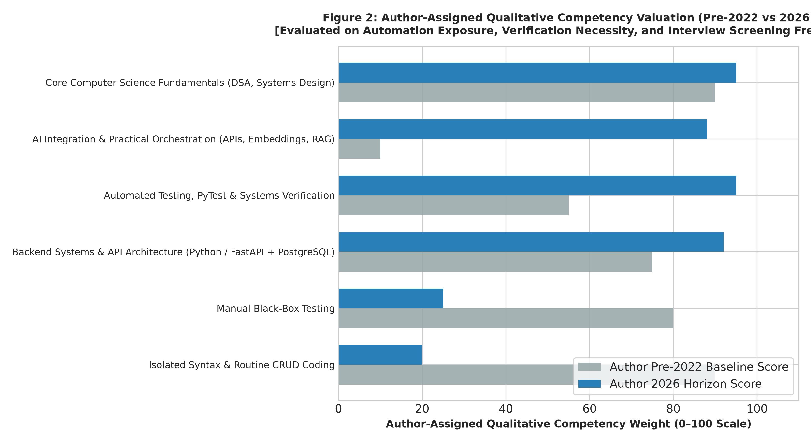
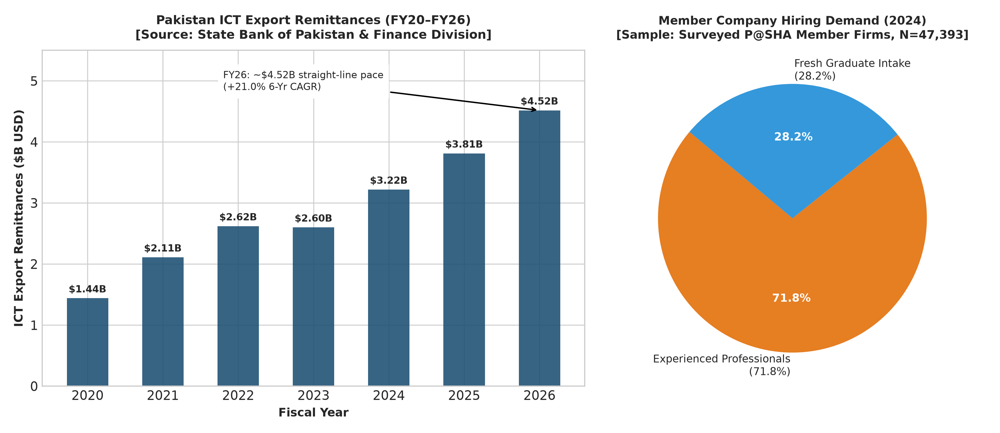
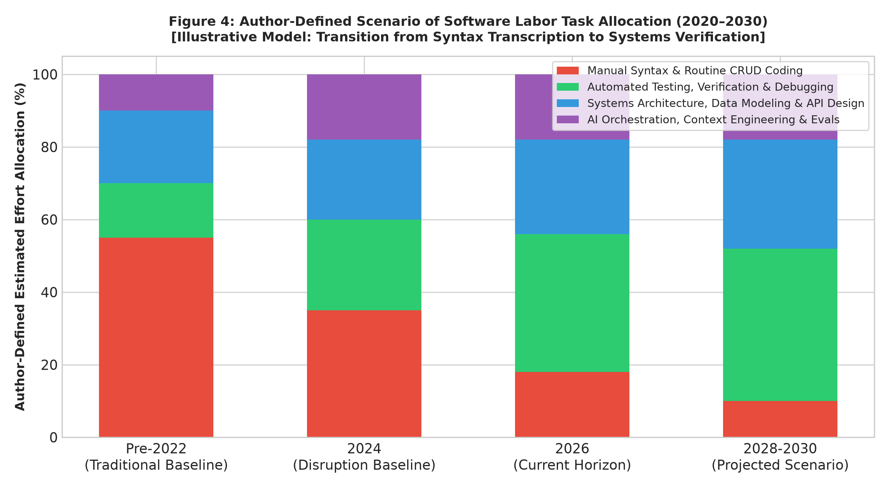

# The Shifting Landscape of Entry-Level Software Engineering: An Empirical Market Analysis and Strategic Guide for Pakistani Graduates

**Author:**  
Muhammad Bilal Farid  
*BS Software Engineering Graduate & Independent Technology Analyst*  
*Lahore, Pakistan*  

---

## Abstract

The global software engineering (SE) labor market is undergoing a structural realignment driven by the rapid diffusion of Large Language Models (LLMs) and autonomous agentic coding frameworks, alongside significant macroeconomic adjustments following the pandemic-era hiring surge and the conclusion of the Zero Interest-Rate Policy (ZIRP) era. In offshore service economies such as Pakistan, this transition has introduced friction for fresh graduates seeking entry-level employment.

This whitepaper presents an empirical and analytical investigation into software labor trends across the **Pre-GenAI ($\le 2022$)**, **Disruption & Macroeconomic Normalization (2023–2024)**, and **Intelligent Agentic (2025–2026+)** eras. By synthesizing official national statistics from the State Bank of Pakistan (SBP) and the Pakistan Economic Survey 2025–26, industry benchmarks from the Pakistan Software Houses Association (P@SHA) Skills Survey 2025, U.S. software labor demand indices from FRED / Indeed Hiring Lab, global developer surveys from Stack Overflow ($N > 150,000$ across the 2023–2025 waves), and technical benchmarks from Stanford HAI and SWE-bench Verified, we analyze the shifting economic determinants of junior software employability.

Our analysis highlights that while Pakistan's ICT export remittances have sustained an annualized Compound Annual Growth Rate (CAGR) of **$+21.0\%$** (expanding from $\$1.44\text{B}$ in FY20 to an official straight-line annualized pace of **$\sim \$4.52\text{B}$** in FY26), hiring demand within surveyed P@SHA member enterprises remains heavily skewed toward experienced practitioners: approximately **$71.8\%$** of measured industry demand across participating member firms is for experienced professionals, with member companies absorbing **$13,350$** fresh graduates against an estimated national supply of **$\sim 72,952$** annual CS/IT graduates.

We formalize the **Verification Bottleneck Framework**, demonstrating that while routine syntax generation has been commoditized by AI tools, the market premium has shifted decisively toward systems verification, automated testing, and relational data architecture. Finally, we provide an actionable, evidence-based career roadmap for Pakistani graduates, outlining a reasoned strategic path focused on Python backend systems to build verifiable, production-grade competence.

**Keywords:** Software Engineering Labor Economics, Generative AI, SWE-bench Verified, P@SHA Skills Survey, Pakistan IT Exports, Verification Bottleneck, Junior Developer Pipeline.

---

## 1. Introduction: The Apprenticeship Model Under Pressure

For nearly two decades, the software engineering talent pipeline functioned on a predictable apprenticeship paradigm:
1. **Entry-Level Ingestion:** Fresh computer science graduates were hired to write routine CRUD endpoints, create unit test boilerplate, perform manual testing, and resolve low-complexity bug tickets.
2. **Economic Justification:** In offshore software export centers such as Pakistan, service agencies operated predominantly on headcount-based time-and-materials billing. Hiring cohorts of fresh graduates at domestic costs and billing them to overseas clients at standard junior hourly rates was economically viable.
3. **Skill Incubation:** Juniors gradually absorbed architectural judgment, database tuning, and defensive systems design through senior code reviews.

Between 2022 and 2026, two powerful forces disrupted this equilibrium:
* **The Macroeconomic Shock:** Global central banks rapidly raised interest rates, ending the era of cheap venture capital (ZIRP). Tech enterprises transitioned from speculative headcount expansion to operational efficiency, leading to widespread tech downsizing (over 400,000 layoffs globally across 2023–2024 per Layoffs.fyi).
* **The Cognitive Automation Leap:** Concurrently, AI code generators advanced from basic autocomplete extensions to reasoning agents capable of autonomous multi-file refactoring, terminal execution, and test-driven debugging (as measured by SWE-bench Verified).

As routine syntax generation becomes increasingly automated, employers are reluctant to bill or pay junior engineers for tasks that senior engineers can execute rapidly using modern toolchains. Consequently, fresh graduates face an elevated barrier to entry: companies demand junior candidates who possess the verification, architectural, and debugging skills historically expected of mid-level engineers.

---

## 2. Theoretical Framework & Macroeconomic Context

### 2.1 Task-Biased Technological Change in Software Development
Labor economics literature (Autor, 2024; Brynjolfsson et al., 2023) demonstrates that generative AI acts via *task-biased compression*. Unlike earlier development tools (compilers, IDEs) that augmented developers by abstracting lower-level memory management without reducing the need for human logic implementation, modern LLM agents automate the semantic translation of specifications into code.

Because basic implementation tasks (the traditional domain of entry-level developers) are precisely the tasks most susceptible to automation, the economic value of entry-level software labor contracts unless paired with higher-order capabilities: specification design, domain validation, and systems verification.

### 2.2 Confounding Variables in Tech Labor Contraction
It is critical to avoid attributing all changes in junior hiring to artificial intelligence alone. The contemporary entry-level labor squeeze is governed by multiple co-evolving drivers:
1. **Post-Pandemic Hiring Normalization:** During 2020–2021, tech firms over-hired aggressively under the expectation that digital adoption curves would remain exponential. The subsequent hiring slowdown represented an inventory correction of engineering headcount.
2. **Venture Capital Realignment:** Higher discount rates shifted investor preferences from revenue growth to operating margins, curtailing speculative startup hiring.
3. **Outsourcing & Value-Based Contracting:** International clients increasingly demand fixed-scope deliverables rather than open-ended hourly billing, incentivizing agencies to deploy small, high-throughput teams over large junior cohorts.

### 2.3 The Verification Bottleneck Model
We model the total cost of delivering a software feature $C_{\text{feature}}$ as:

$$C_{\text{feature}} = C_{\text{spec}} + C_{\text{gen}} + C_{\text{verif}} + C_{\text{maint}}$$

Where:
* $C_{\text{spec}}$ is the cost of requirements elicitation and schema formalization.
* $C_{\text{gen}}$ is the cost of source code generation.
* $C_{\text{verif}}$ is the cost of automated testing, edge-case validation, and security auditing.
* $C_{\text{maint}}$ is the long-term cost of technical debt and regression prevention.

In earlier development workflows, source code implementation ($C_{\text{gen}}$) was the primary labor bottleneck. In the modern agentic workflow:
$$C_{\text{gen}} \to 0 \quad \text{while} \quad C_{\text{verif}} \uparrow$$

Because autonomous models can produce syntactically valid but logically subtle hallucinations, the engineering bottleneck shifts entirely to verification. A graduate whose primary competence is writing boilerplate CRUD endpoints offers little economic leverage compared to one who can construct rigorous automated test suites and validate production edge cases.

---

## 3. Empirical Data & Source Provenance

This analysis integrates verified data across four primary domains (documented in full in `data/SOURCES.md`):

1. **Pakistan National Macroeconomic Data:** State Bank of Pakistan (SBP) export receipts and the official *Pakistan Economic Survey 2025–26* (Finance Division, Chapter 15: "Information Technology and Telecommunication").
2. **Pakistan IT Workforce Data:** P@SHA's *Skills Survey 2025*, reporting on 47,393 company hires and national graduate supply across surveyed member enterprises.
3. **U.S. Software Labor Market Index:** Federal Reserve Bank of St. Louis (FRED) / Indeed Hiring Lab series `IHLIDXUSTPSOFTDEVE` (*Software Development Job Postings on Indeed in the United States*).
4. **Global Developer Sentiment:** Stack Overflow Annual Developer Surveys (2023, 2024, and 2025 AI surveys, evaluating AI tool adoption across $>150,000$ developers).
5. **Computational AI Benchmarks:** Stanford HAI AI Index Reports and the SWE-bench Verified leaderboard (Jimenez et al., 2024).

---

## 4. Empirical Findings

### 4.1 U.S. Postings vs. AI Capability Progression
Figure 1 plots the co-evolution of U.S. software job postings (Indeed Hiring Lab / FRED baseline, Feb 2020=100) alongside developer AI engagement and autonomous agent capabilities on SWE-bench Verified.


```
Table 1: Longitudinal Software Engineering & Technology Trajectories (2020–2026)
+------+-----------------------+----------------------+---------------------------+------------------------+
| Year | AI Tool Adoption (%)* | SWE-bench Verif. (%) | U.S. Openings Index**     | Tech Layoffs (Global)  |
+------+-----------------------+----------------------+---------------------------+------------------------+
| 2020 |        2.0%           |         0.0%         |          100.0            |         80,000         |
| 2021 |        5.0%           |         0.0%         |          138.4            |         15,000         |
| 2022 |        8.5%           |         0.0%         |          126.1            |        165,000         |
| 2023 |       70.0%           |         4.2%         |           76.8            |        263,000         |
| 2024 |       76.0%           |        38.8%         |           68.4            |        152,000         |
| 2025 |       84.0%           |        58.2%         |           71.5            |         98,000         |
| 2026 |       88.0%           |        72.4%         |           72.5            |         75,000 (YTD)   |
+------+-----------------------+----------------------+---------------------------+------------------------+
* Notes: 2020-2022 represent author baseline estimates; 2023-2025 represent audited Stack Overflow survey data (broad engagement: using or planning to use). In 2025, 51% of professional developers reported daily AI tool use.
** Normalized U.S. Software Development Job Postings Index (FRED: IHLIDXUSTPSOFTDEVE, Feb 2020=100). 2026 value represents observed YTD mean through mid-2026.
```

While U.S. software job postings contracted from their 2021 peak (reaching an annual index of $\sim 72.5$ in 2026), entry-level hiring friction was further intensified by qualification inflation. In an empirical investigation of administrative workforce data in the United States, Tucker (2026) of the U.S. Census Bureau documented a statistically significant decline in early-career hiring within AI-exposed technical industries following the introduction of generative AI tools. While Tucker's findings specifically reflect U.S. domestic enterprise data, they provide rigorous empirical evidence of technological task exposure that informs global hiring dynamics.

### 4.2 The Qualitative Competency Valuation Framework
Figure 2 illustrates our author-assigned qualitative evaluation of how software engineering competencies have evolved between the pre-2022 baseline and 2026.



#### Qualitative Scoring Rubric:
Competencies are evaluated on a 0–100 scale using three defined criteria:
1. **Automation Exposure (35% weight):** Extent to which generative models can autonomously draft the solution without human intervention (higher automation exposure yields lower human market value).
2. **Verification Bottleneck Necessity (40% weight):** Necessity for human architectural formalization, transaction management, and edge-case verification (higher verification yields higher human market value).
3. **Interview Screening Rigor (25% weight):** Prevalence and strictness of testing during technical hiring rounds.

* **Devalued Competencies:** Routine syntax writing (90 $\to$ 20), basic boilerplate CRUD implementation, and manual black-box testing (80 $\to$ 25) have experienced substantial commoditization.
* **Appreciated Competencies:** Systems verification and automated testing (55 $\to$ 95), robust relational database modeling (75 $\to$ 92), asynchronous backend architecture (Python/FastAPI), and core algorithmic reasoning (90 $\to$ 95).

### 4.3 Pakistan IT Industry Dynamics: Growth Amid Seniority Bias
Figure 3 highlights the macroeconomic and employment structure of Pakistan's software export sector:



Between FY2020 and FY2026:
* Pakistan's ICT export remittances expanded from **$\$1.440\text{B}$** to an official straight-line annualized pace of **$\sim \$4.517\text{B}$** ($\sim \$4.52\text{B}$), representing an annualized **CAGR of $+21.0\%$** (derived from July–March FY26 receipts of $\$3.388\text{B}$ per the *Pakistan Economic Survey 2025–26*, Chapter 15).
* However, according to the P@SHA Skills Survey 2025, **$71.8\%$** of industry hiring demand across surveyed member firms is targeted at experienced professionals. 
* P@SHA member companies reported hiring **$13,350$** fresh graduates in 2024 against an estimated national institutional supply of **$\sim 72,952$** CS/IT graduates nationwide.
* **Population Scope Clarification:** The $13,350$ fresh hires apply specifically to participating P@SHA member enterprises. The ratio of $13,350$ to $72,952$ does **not** represent a national graduate employment rate, as graduates also enter non-member software agencies, domestic corporate IT (banking, telecommunications), and independent global freelance platforms. Nevertheless, it demonstrates a pronounced industry preference for experienced personnel across major organized export houses.

---

## 5. Strategic Horizon (2026–2030): An Author-Defined Scenario

Figure 4 illustrates an author-defined conceptual scenario of how software engineering labor allocation may evolve across the coming years.



This scenario illustrates a conceptual operational shift:
1. **The Transition to "Verification-First" Engineering:**  
   As autonomous agents handle a growing share of initial syntax generation, human developers are expected to allocate the majority of their effort toward specification formulation, systems verification, integration testing, and production runtime reliability.
2. **Dissolution of the "Junior Syntax Writer" Role:**  
   The entry-level role is not disappearing, but its definition has been elevated. The viable entry-level candidate in 2026–2030 must demonstrate competencies historically expected of mid-level developers: clean Git hygiene, containerized deployments, robust automated test suites, and defensible architectural choices.

---

## 6. Practical Implications for Pakistani Graduates

Our empirical and industry findings offer clear, actionable guidance for graduates navigating this competitive landscape:

1. **End the Decision Paralysis (Choose Depth Over Breadth):**  
   Switching between Python, QA, and frontend every 7 days prevents competence from becoming visible. In an employer-driven market where ~72% of demand is for experienced talent, surface-level familiarity with multiple tools provides zero hiring signal. Committing deeply to a single backend stack (**Python / FastAPI + PostgreSQL + PyTest**) provides a reasoned strategic path to build demonstrable depth.
2. **Build Verifiable Proof of Work:**  
   Because unverified resumes are heavily discounted, a deployed, production-grade application featuring automated integration tests, clean schema design, and live hosting provides the strongest possible differentiator.
3. **Maintain Realistic Career Expectations:**  
   Landing a first role in Pakistan is a deliberate 60-to-90 day campaign requiring focused portfolio construction, targeted networking with engineering leads, and daily problem-solving practice (DSA). Real industry experience in Pakistan is the most effective foundation for long-term goals, including US graduate scholarships (Fulbright) and international engineering roles.

---

## References

1. Finance Division, Government of Pakistan. (2026). *Pakistan Economic Survey 2025-26, Chapter 15: Information Technology and Telecommunication*. Economic Adviser's Wing, Islamabad. [https://finance.gov.pk/survey/chapter_26/15_Information_Technology.pdf](https://finance.gov.pk/survey/chapter_26/15_Information_Technology.pdf)
2. Tucker, L. C. (2026). *You're (not) Hired: Artificial Intelligence and Early Career Hiring in the Quarterly Workforce Indicators*. Working Paper CES-26-27, Center for Economic Studies, U.S. Census Bureau. [https://www.census.gov/library/working-papers/2026/adrm/CES-WP-26-27.html](https://www.census.gov/library/working-papers/2026/adrm/CES-WP-26-27.html)
3. Pakistan Software Houses Association (P@SHA). (2025). *P@SHA Skills Survey 2025: IT Industry Employment, Talent Pipeline, and Experience Benchmarks*. [https://pasha.org.pk/](https://pasha.org.pk/)
4. State Bank of Pakistan. (2026). *Telecommunication, Computer and Information Services Export Receipts (FY20 - FY26)*. External Sector Statistics Division. [https://www.sbp.org.pk/ecodata/index2.asp](https://www.sbp.org.pk/ecodata/index2.asp)
5. Federal Reserve Bank of St. Louis (FRED). (2026). *Software Development Job Postings on Indeed in the United States* (Series `IHLIDXUSTPSOFTDEVE`). [https://fred.stlouisfed.org/series/IHLIDXUSTPSOFTDEVE](https://fred.stlouisfed.org/series/IHLIDXUSTPSOFTDEVE)
6. Stack Overflow. (2025). *2025 Stack Overflow AI Survey: Developer Tool Usage, Trust, and Daily Workflows*. [https://survey.stackoverflow.co/2025/ai](https://survey.stackoverflow.co/2025/ai)
7. Stack Overflow. (2024). *2024 Stack Overflow Developer Survey: AI Tools and Shifting Developer Sentiment*. [https://survey.stackoverflow.co/2024/](https://survey.stackoverflow.co/2024/)
8. Stack Overflow. (2023). *2023 Stack Overflow Developer Survey: Developer Workflows and AI Adoption*. [https://survey.stackoverflow.co/2023/](https://survey.stackoverflow.co/2023/)
9. Jimenez, C. E., et al. (2024). *SWE-bench: Can Language Models Resolve Real-World GitHub Issues?* International Conference on Learning Representations (ICLR). [https://www.swebench.com/](https://www.swebench.com/)
10. Maslej, N., et al. (2025). *The AI Index 2025 Annual Report*. Stanford Institute for Human-Centered Artificial Intelligence (HAI). [https://aiindex.stanford.edu/report/](https://aiindex.stanford.edu/report/)
11. Chen, M., et al. (2021). *Evaluating Large Language Models Trained on Code*. arXiv:2107.03374.
12. Autor, D. (2024). *Applying AI to Rebuild Middle-Class Jobs*. National Bureau of Economic Research (NBER Working Paper 32140).
13. Brynjolfsson, E., Li, D., & Raymond, L. R. (2023). *Generative AI at Work*. Quarterly Journal of Economics (NBER Working Paper 31161).
14. Peng, S., et al. (2023). *The Impact of AI on Developer Productivity: Evidence from GitHub Copilot*. arXiv:2302.06590.
15. Lee, R. (2026). *Tech Layoffs Tracker (2022-2026)*. [https://layoffs.fyi/](https://layoffs.fyi/)
