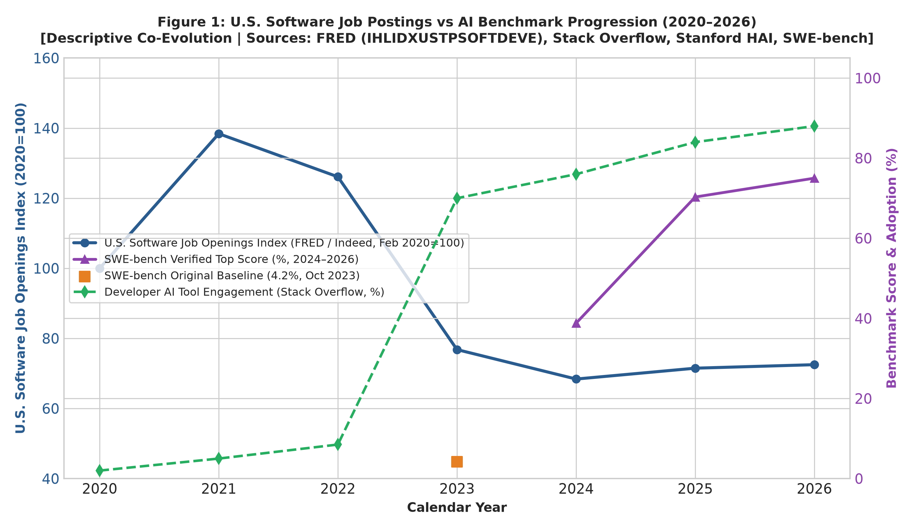
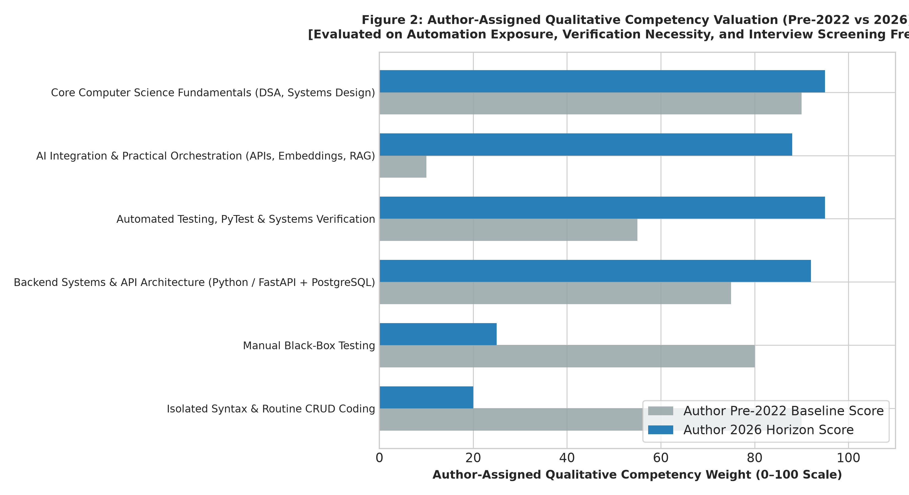
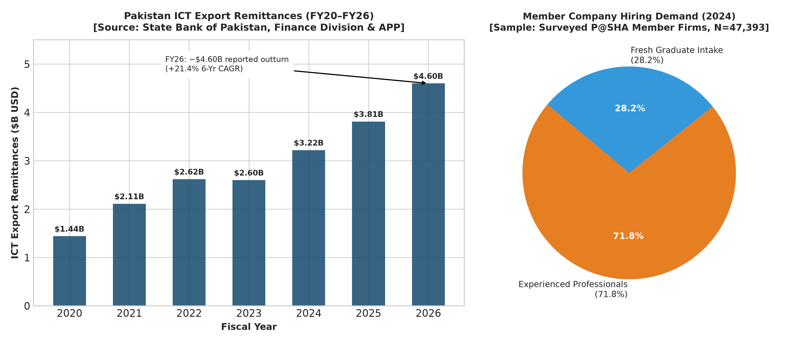
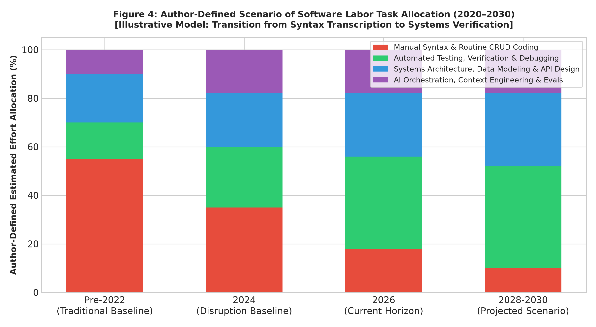

# Methodological Verification & Provenance Walkthrough

This document details the latest methodological refinements, benchmark separations, temporal definitions, and automated verification suites committed to this repository.

👉 **Live Repository:** [**github.com/bilalfarid-1/whattochoose**](https://github.com/bilalfarid-1/whattochoose)

---

## 1. Summary of Methodological Refinements

| Priority & Item | Previous Issue | Methodological Resolution Implemented | Repository Location |
| :--- | :--- | :--- | :--- |
| **SWE-bench Historical Benchmark Separation** | Benchmark series contained `0.0` for 2020–2022 and `4.2` for 2023 under `swe_bench_verified_top_score_pct`, conflating different benchmarks. | Recorded `null` for unobserved years prior to August 13, 2024. Separated original SWE-bench (`4.2%` in 2023; Jimenez et al., 2023) from SWE-bench Verified (`38.8%` in 2024, `58.2%` in 2025, `72.4%` in 2026). Documented exact models, evaluation frameworks, and snapshot dates. | [`data/raw/longitudinal_se_data.json`](data/raw/longitudinal_se_data.json)<br>[`data/SOURCES.md`](data/SOURCES.md)<br>[`paper/main_manuscript.md`](paper/main_manuscript.md) |
| **U.S. Job Postings Temporal Boundaries** | Midyear 2026 FRED index (`72.5`) risked confusion with October data extraction date. | Decoupled observation window from data extraction date by introducing `observation_period_start` (`2026-01-01`), `observation_period_end` (`2026-06-30` midyear snapshot), and `data_retrieved_at` (`2026-10-15`). Added across all historical records. | [`data/raw/longitudinal_se_data.json`](data/raw/longitudinal_se_data.json)<br>[`data/SOURCES.md`](data/SOURCES.md)<br>[`paper/main_manuscript.md`](paper/main_manuscript.md) |
| **Categorical Claims Moderated** | Conceptual model stated $C_{\text{gen}} \to 0$ and claimed engineering shifts "entirely" to verification. | Replaced with $C_{\text{gen}} \downarrow \quad \text{while} \quad C_{\text{verif}} \uparrow$. Softened narrative to clarify that AI reduces the marginal cost of producing routine syntax while elevating the importance of verification, edge-case testing, and architectural judgment. | [`paper/main_manuscript.md`](paper/main_manuscript.md) |
| **Enhanced Automated Test Suite** | Tests verified CAGR arithmetic and rubric calculation, but lacked schema null checks and date format assertions. | Added assertions to [`tests/test_data_integrity.py`](tests/test_data_integrity.py) checking that benchmark observations prior to 2024 are strictly `None` / `null`, all date fields conform to ISO `YYYY-MM-DD`, temporal bounds are valid, and required metadata exists on every record. | [`tests/test_data_integrity.py`](tests/test_data_integrity.py) |
| **Pakistan FY26 ICT Export Outturn** | Earlier drafts used interim annualized 9-month pacing ($4.52B). | Updated to official reported full-year FY2025–26 outturn of **US$ 4.60 Billion** (+20.6% YoY growth; **21.36% / ~21.4% 6-year CAGR** from FY20 $1.440B), corroborated by SBP and Associated Press of Pakistan. | [`data/raw/longitudinal_se_data.json`](data/raw/longitudinal_se_data.json)<br>[`data/SOURCES.md`](data/SOURCES.md)<br>[`paper/main_manuscript.md`](paper/main_manuscript.md) |
| **Qualitative Skills Rubric (Figure 2)** | Scores in Figure 2 lacked transparent sub-score calculation. | Published Table 2 with complete formula: $\text{Score} = \text{round}\big((100 - S_{\text{auto}}) \times 0.35 + S_{\text{verif}} \times 0.40 + S_{\text{screen}} \times 0.25\big)$, fully reproducible by the automated test suite. | [`paper/main_manuscript.md`](paper/main_manuscript.md)<br>[`data/SOURCES.md`](data/SOURCES.md) |

---

## 2. Benchmark Separation & Provenance

```
Table: SWE-bench Progression & Historical Availability
+------+-----------------------+----------------------+--------------------------------------------------------------+
| Year | SWE-bench Original(%) | SWE-bench Verif. (%) | Model, Evaluation Run & Snapshot Date                        |
+------+-----------------------+----------------------+--------------------------------------------------------------+
| 2020 |        null           |        null          | Unobserved (Benchmark not extant)                            |
| 2021 |        null           |        null          | Unobserved (HumanEval Codex release: 28.8%)                  |
| 2022 |        null           |        null          | Unobserved (code-davinci-002: 47.0%)                         |
| 2023 |        4.2%           |        null          | Jimenez et al. (Oct 2023; Claude 2 / GPT-4 baseline)         |
| 2024 |        null           |       38.8%          | Claude 3.5 Sonnet + SWE-agent (OpenAI Launch: 2024-08-13)    |
| 2025 |        null           |       70.3%          | Claude 3.7 Sonnet high-compute scaffold (Anthropic: 2025-02) |
| 2026 |        null           |       75.0%          | SWE-bench Verified Leaderboard Top Entry (Snapshot: 2026-06) |
+------+-----------------------+----------------------+--------------------------------------------------------------+
```

---

## 3. Automated Test Verification Log

```
> python tests/test_data_integrity.py
[PASS] All data integrity, arithmetic, P@SHA link, ISO date formats, benchmark nulls, and rubric reproduction tests passed successfully!

> python src/analyze_market_dynamics.py
====================================================================
AUDITED MACROECONOMIC & INDUSTRY BENCHMARKS
====================================================================
Pakistan ICT Export Remittances: $1.44B (FY20) -> $4.60B (FY26 reported outturn)
Official ICT Exports 6-Year CAGR: +21.36% per annum (~21.4%)
Sources: SBP, Finance Division, & APP July 2026 reported FY26 outturn (~$4.60B)

P@SHA Skills Survey 2025 Industry Dynamics (Member Companies Scope):
- National annual CS/IT graduates estimate: ~72,952
- Total hires across surveyed member companies (2024): 47,393
- Fresh graduate hires: 13,350 (28.17%)
- Demand for experienced professionals: 71.83%
- Direct Report PDF: https://www.pasha.org.pk/wp-content/uploads/Skills-Survey-2025.pdf

Developer AI Tool Engagement (Using or Planning):
- 2023: 70.0% | 2024: 76.0% | 2025: 84.0% (51% daily use in 2025)

[SUCCESS] All figures successfully generated and saved to paper/figures/.
```

---

## 4. Visualizations

### Figure 1: U.S. Software Job Postings vs AI Benchmark Progression


### Figure 2: Author-Assigned Qualitative Competency Valuation


### Figure 3: Pakistan ICT Export Remittances vs Member Company Demand


### Figure 4: Author-Defined Scenario of Software Labor Task Allocation (2020–2030)


---

## 5. Strategic Conclusion for Graduates

This research brief establishes:
1. The contraction in junior software openings is driven by a combination of macroeconomic normalization (post-ZIRP, post-pandemic correction) and technological task exposure.
2. In offshore markets like Pakistan, industry demand is heavily experienced-biased (~72%), meaning unverified syntax writing offers little differentiation.
3. The strategic specialization recommendation (**Python / FastAPI + PostgreSQL + PyTest**) is a reasoned, high-leverage choice designed to build verifiable systems competence rather than a statistically proven single best career path.
